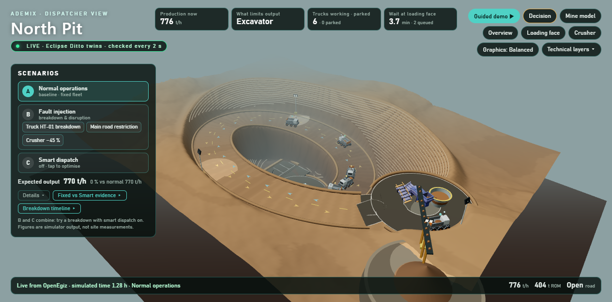

# Ademix Digital Mine

[](LICENSE)
[](https://github.com/ahmadshahyawar/Digital-Mine-on-OpenEgiz/actions/workflows/ubuntu-release-verification.yml)
[](https://github.com/aleka07/openegiz)

Ademix is an interactive 3D digital twin of an open-pit mine's loading, haulage, road and primary-crusher circuit. Six haul trucks move between an excavator and crusher while Eclipse Ditto twins track equipment state, production, queues, road conditions and scenario effects.



## Highlights

- **Real OpenEgiz data path:** simulator → MQTT → Eclipse Ditto → API → React/Three.js interface.
- **11 connected digital twins:** mine, six haul trucks, excavator, road, crusher and scenario controller.
- **Operational simulation:** deterministic queues, exclusive loading/dumping resources, finite ROM inventory and mass conservation.
- **Decision support:** bottleneck analysis, fleet sizing and Smart Dispatch that parks surplus trucks.
- **Interactive what-if analysis:** truck breakdown, road restriction and crusher slowdown with clean reset.
- **Reproducible deployment:** Docker Compose, no API keys, paid services or external dataset download.
- **Transparent evidence:** synthetic telemetry, sourced parameters, assumptions, licenses and limitations are documented.

## Architecture

```text
Deterministic Python simulation
           │ Ditto Protocol telemetry
           ▼
      MQTT / Mosquitto
           │ OpenEgiz connection
           ▼
      Eclipse Ditto twins
           │ authenticated HTTP reads
           ▼
       Ademix API ─────► React + Three.js 3D Command Center
           │
           └──────────► InfluxDB / Grafana telemetry pipeline
```

The browser never reads the simulator directly. Operational updates are published through MQTT into Eclipse Ditto, and the interface reads the resulting twin state back through the Ademix API.

## Quick start

### Requirements

- Ubuntu 24.04 amd64 or Docker Desktop with Linux containers
- Docker Engine 29 or compatible
- Docker Compose v2

No GPU, Node.js, Python installation, API key or external dataset download is required.

From the repository root:

```bash
bash scripts/compose-env.sh
docker compose --env-file deploy/compose/.env \
  -f deploy/compose/docker-compose.yml \
  -f ademix/compose.yml \
  up -d --build --wait --wait-timeout 900
```

Open:

- **Ademix 3D Command Center:** <http://localhost:4173>
- **OpenEgiz/Grafana:** <http://localhost:3000>
- **Ademix health endpoint:** <http://localhost:8088/api/health>

Generated credentials are stored in the ignored `deploy/compose/.env` file. They are not required to use the 3D command center.

## Explore the twin

1. Wait for the header to show `LIVE · Eclipse Ditto twins`.
2. Select a truck to inspect payload, fuel, speed, position, trips and cycle time.
3. Enable **Smart dispatch** to keep four trucks cycling and park two empty trucks under normal conditions.
4. Trigger **HT-01 breakdown** to stop the truck and observe directional traffic blockage.
5. Trigger **Main road restriction** to reduce moving-truck speed from 25 to approximately 10.72 km/h.
6. Trigger **Crusher capacity −45%** to reduce capacity from 900 to 495 t/h and accumulate ROM inventory.
7. Select **Normal operations** to restore fixed dispatch and the baseline condition.

Scenario controls change the simulation state and publish the result through OpenEgiz. Allow several seconds for the MQTT/Ditto publication cycle and frontend polling.

| Operating condition | Modeled effect | Smart Dispatch |
|---|---|---|
| Baseline | Loader-limited, 770 t/h | 4 cycling, 2 standby |
| HT-01 breakdown | Five healthy trucks after recovery | 4 cycling, 1 standby |
| Road restriction | Haulage-limited, approximately 647 t/h | All 6 trucks needed |
| Crusher slowdown | Crusher-limited, 495 t/h | 3 cycling, 3 standby |

All figures are outputs of the synthetic model, not measurements or production forecasts.

## Verify the live system

Run the read-only smoke check:

```bash
docker compose --env-file deploy/compose/.env \
  -f deploy/compose/docker-compose.yml \
  -f ademix/compose.yml \
  run --rm --no-deps ademix-simulator \
  python smoke_check.py --base-url http://ademix-ui
```

It requires the real Eclipse Ditto source and validates all 11 twins plus 143 required fields and units.

Run the complete fixed/Smart Dispatch scenario matrix and final reset:

```bash
docker compose --env-file deploy/compose/.env \
  -f deploy/compose/docker-compose.yml \
  -f ademix/compose.yml \
  run --rm --no-deps ademix-simulator \
  python verify_scenarios.py --url http://ademix-ui
```

Run the deterministic simulator test suite:

```bash
docker compose --env-file deploy/compose/.env \
  -f deploy/compose/docker-compose.yml \
  -f ademix/compose.yml \
  run --rm --no-deps ademix-simulator \
  python -m unittest discover -s /app/simulator -p 'test_*.py' -v
```

The verified release includes **98 simulator/API tests**, **48 data-layer tests**, a production frontend build, repeated live Ditto smoke checks and a full scenario matrix/reset. The complete Ubuntu integration workflow is available in [`.github/workflows/ubuntu-release-verification.yml`](.github/workflows/ubuntu-release-verification.yml).

## Simulation timing

The demonstration runs at **20 simulated seconds per wall-clock second**. The authoritative `sim_time_s`, multiplier and mode are published on the `mine-01` twin. One complete 11-twin snapshot is spread across a five-second wall-clock cycle; the frontend checks every two seconds and the API cache lasts up to three seconds.

Acceleration shortens demonstration waiting only. It does not change modeled travel, loading, dumping, production, queue or recovery equations.

## Repository map

| Path | Purpose |
|---|---|
| `ademix/simulator/` | Simulation engine, MQTT publisher, Ditto API and tests |
| `ademix/frontend/` | React/Three.js 3D command center |
| `ademix/data/` | Fleet specification, telemetry dictionary, evidence and calibration data |
| `ademix/compose.yml` | Ademix services layered onto OpenEgiz |
| `deploy/compose/` | OpenEgiz Docker Compose deployment |
| `.github/workflows/` | Clean Ubuntu integration and restart verification |
| `docs/images/` | Project screenshots used in this documentation |
| `DATA_LICENSES.md` | Data and asset provenance |

## Data and limitations

The mine is a fictional, reduced visualization calibrated from the anonymized North Pit configuration distributed by the MIT-licensed [OpenMines](https://github.com/370025263/openmines) project. Live telemetry is synthetic and deterministic.

This project is a decision-demonstration model—not an engineering design, safety system or production forecast. It models one loading–haulage–crusher circuit rather than an entire mine. Route geometry is not surveyed, equipment is simplified and only one operating disruption is active at a time. See the [simulation model documentation](ademix/simulator/MODEL.md), [scenario documentation](ademix/simulator/SCENARIOS.md) and [data provenance](DATA_LICENSES.md) for details.

## Team

- [Ahmad Shah Yawar](https://github.com/ahmadshahyawar) — product direction, backend, integration and release verification
- [Professor](https://github.com/TurkenGulzat) — frontend, 3D experience, visual assets and presentation

The project was developed with assistance from OpenAI Codex and Anthropic Claude. Contributor history is preserved in Git.

## Stop the stack

```bash
docker compose --env-file deploy/compose/.env \
  -f deploy/compose/docker-compose.yml \
  -f ademix/compose.yml \
  down
```

This preserves named data volumes. Add `-v` only when you intentionally want to delete deployment data.

## License and credits

Team code is released under the [MIT License](LICENSE). Included third-party code, data and assets retain their recorded licenses; see [DATA_LICENSES.md](DATA_LICENSES.md), [NOTICE](NOTICE) and [LICENSES/](LICENSES/).

Ademix builds on [OpenEgiz v1.0.4](https://github.com/aleka07/openegiz).
